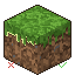

# Grass Seam Fix

Client-side Fabric mod that removes the thin light lines along the grass/dirt edges of grass block sides.

Fixes [MC-303669](https://bugs.mojang.com/browse/MC-303669): The grass block side overlay no longer covers it in a pixel-perfect way.
